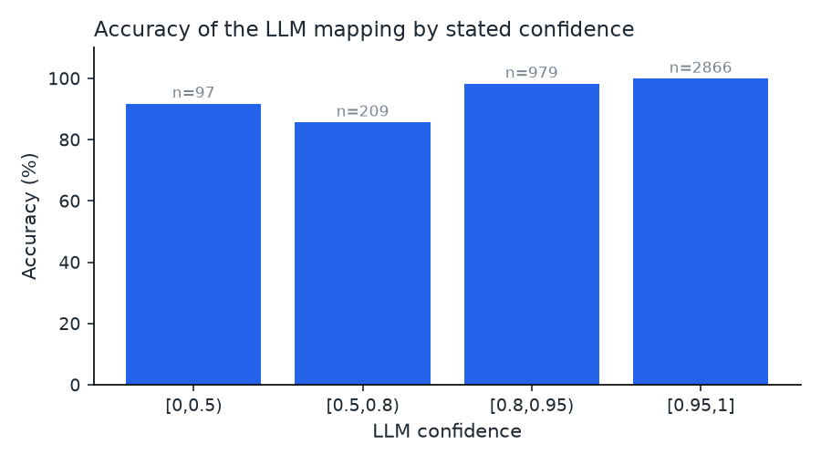
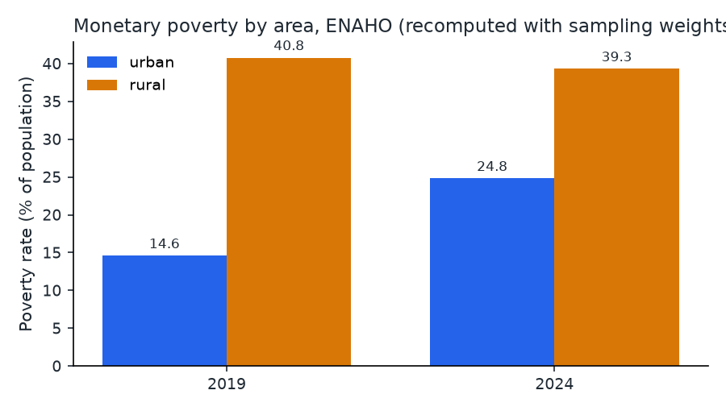
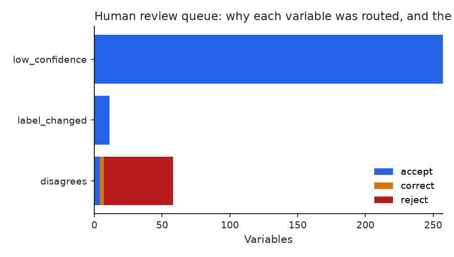

# ENAHO harmonization with an LLM, human validation and a weighted poverty benchmark

A reproducible pipeline that harmonizes two years (2019 and 2024) of **ENAHO**, Peru's national household
survey (INEI). Its steps:

1. **An LLM proposes the mapping.** It maps every source variable to a common target schema.
2. **The mapping is evaluated** against a ground truth reviewed by a person (status in Results).
3. **Doubtful cases go to a person.** They are routed to a human review queue.
4. **Indicators are computed with sampling weights.** These are poverty, extreme poverty, employment and
   informality, nationally and by urban/rural area.
5. **The result is checked against INEI.** It must reproduce the official poverty rates.

This is a small portfolio project. It is evidence of how I approach AI-assisted survey harmonization, not a
claim of professional experience with household surveys.

## Results

<!-- RESULTS:START -->
**LLM mapping** (Claude Haiku 5.5, every variable of modules 02, 03, 05 and 34 in both years)

| Metric | Value |
|---|---|
| Source variables mapped | 4,151 |
| Variables that belong to the schema (ground truth) | 172 |
| Accuracy on those variables (right target) | 98.3% |
| Recall (recognised as mappable) | 98.3% |
| Precision of the mapped calls | 75.4% |
| Accuracy on out-of-schema variables (`none`) | 98.6% |
| Invalid answers | 0 |
| Tokens (input / output) | 239,781 / 276,080 |
| Cost | USD 0.17 |

**Human review:** 326 variables routed to review, 326 decided, 54 changed by the reviewer (corrected or rejected).

**Ground truth:** 45 of 46 manual ground-truth rows signed off by a human reviewer.

**Poverty benchmark against INEI** (population-weighted, % of population; tolerance ±0.5 pp)

| Year | Measure | This pipeline | INEI | Difference (pp) | Within tolerance |
|---|---|---|---|---|---|
| 2019 | poverty | 20.19 | 20.2 | -0.01 | yes |
| 2019 | extreme_poverty | 2.85 | 2.9 | -0.05 | yes |
| 2024 | poverty | 27.58 | 27.6 | -0.02 | yes |
| 2024 | extreme_poverty | 5.50 | 5.5 | +0.00 | yes |
<!-- RESULTS:END -->





## Pipeline

```
fetch        INEI zips -> data/raw/{year}/m{02,03,05,34}.dta                (git-ignored)
dictionary   names, labels and value labels -> data/interim/dictionary.csv   (metadata only)
llm          Claude Haiku 5.5 maps each variable to schema/target.yaml or "none",
             with a confidence and a justification -> data/llm_cache/*.json (committed)
evaluate     metrics vs ground truth -> reports/llm_metrics.json
             review queue -> validation/review_queue.csv
harmonize    LLM proposal + human decisions -> reports/final_mapping.csv (provenance per variable)
             household and person tables -> data/processed/*.parquet         (git-ignored)
indicators   weighted rates with DuckDB -> reports/{poverty,labour,benchmark}.csv
report       this README's results block and figures
```

## How the LLM is evaluated

**Target schema.** `schema/target.yaml` holds 59 targets:

- **Direct targets (52):** identifiers and survey design, demography, education, employment and income, and
  household poverty variables.
- **Derived targets (7):** area, years of schooling, employed, informal, labour income, poor and extreme poor.
  These are coded by hand in `src/enahoharm/harmonize.py`; the LLM is never asked for derivation rules.

**What the LLM sees.** It receives every variable of the four modules for both years (about 4,150), in batches
of 40 from one year and module. For each it gets the name, Spanish label and value labels. Its answer is
constrained to a JSON schema whose target field is an enum of the schema names plus `none`.

**Ground truth.** It is built in two layers:

- **Automatic:** the INEI source names of each target (`source_names` in the schema).
- **Manual:** rows in `validation/ground_truth.csv`. They cover every schema variable whose label changed
  between years, or that exists in only one year, plus a random audit sample of 30 automatic rows. These
  rows were drafted by the AI assistant; each counts as signed off only when I fill `reviewed_by`, and the Results block reports how many are signed.

**Metrics.**

| Metric | Meaning |
|---|---|
| Accuracy on mappable variables (headline) | Share assigned to the right target |
| Recall | Share recognised as mappable |
| Precision | Share of the LLM's mapped calls that were right |
| Accuracy on `none` | Correct calls on out-of-schema variables |
| Calibration | Accuracy by confidence bucket |
| Usage | Tokens and cost |

**Human review.** A variable goes to `validation/review_queue.csv` when any of these holds:

- the answer was invalid;
- it disagrees with the ground truth;
- its label changed between years;
- the LLM's confidence is below 0.8.

The reviewer records `accept`, `correct` (with the right target) or `reject`. The final mapping is the LLM's
proposal overridden by those decisions, with provenance recorded per variable: `llm`, `human_accepted` or
`human_corrected`.

## Reproduce

```bash
conda env create -f environment.yml
conda activate enaho-harm
make all      # downloads ENAHO (~600 MB), runs every stage from the committed LLM cache (no API key needed once data/llm_cache/ is populated)
make test lint
```

`make llm` calls the API only for variables missing from the cache. It needs `ANTHROPIC_API_KEY` and stops if
the estimated spend passes USD 10. The key is read only by the Anthropic SDK and never printed, logged or
stored.

## Limitations

- **Narrow scope.** It covers two years, one country and four modules, and tests one model (no comparison
  across models or prompts).
- **One reviewer.** The ground truth and the review were done by one person. The automatic layer assumes that
  an unchanged INEI variable name means an unchanged concept, which the audit sample checks only partially.
- **Informality is missing in 2024.** The 2024 module 05 has no informality variable (`ocupinf` and
  `emplpsec` exist only in 2019), so the 2024 informality rate is not reported.
- **Income deflation is unclear for 2024.** The 2019 income labels say "deflated, annualized"; the 2024
  labels say only "annual". Labour incomes are therefore not compared across years.
- **Years of schooling is an approximation** from level and last year or grade; see `docs/methodology.md`.

## Data and citation

Microdata: INEI, *Encuesta Nacional de Hogares (ENAHO)*, annual 2019 and 2024, modules 02, 03, 05 and 34,
from the INEI microdata portal. Raw files are not redistributed here.

Official figures for the benchmark: INEI, *Evolución de la Pobreza Monetaria*, informes técnicos 2020 (for
2019) and 2025 (for 2024).

The code was written with the help of an AI coding assistant. The design decisions, the review of the ground
truth and the human-validation decisions are mine (see `reviewed_by` and `decision` in validation/).

## License

MIT, see `LICENSE`.
